# Kimodo 独立空中下落 Pipeline

`tools/produce_als_resources.py --scope air` 与平面 locomotion、Mantle 制作并行。独立实现位于 `tools/kimodo_pipeline/air.py`，配置为 `air_rules.json`，策略为 `als-airborne-loop-v1`。完整非道具生产图也将 fall / flail 分派到此专用分支。

## 范围与入口

当前覆盖 Fall、Fall_Fast、Flail 三个独立生成动作，以及由 Fall 首帧派生的 Air Lean 中性和前后左右姿态，按原身份交付到 V4 / Refactored。单独选择 Air 时裁掉全部无关节点，没有 Stand / Walk / Mantle 依赖，不执行通用固定比例裁剪或末尾折返 `loop`。

Jump、Land、Ragdoll 恢复保留各自现有分支；此策略不声称已覆盖全部空中动作。

三种下落生成 prompt 均描述每个周期中段双膝与髋部弯曲、短暂蹲缩，随后自然伸腿回到起始空中姿态。Fall 保留放松手臂，Fall_Fast 保留保护性展臂，Flail 保留双臂挥动。这里的蹲缩是空中收腿动作；髋部高度、全身／Hips 条件和既有源／目标门禁继续约束输出。文字指定中段不等于精确时间键控制，实际生成是否出现清晰蹲缩需由新批次验证。

```powershell
# 只读检查；默认自动选择 air_rules.json
python tools/produce_als_resources.py inspect --scope air

# 生成完整计划，输出独立目录
python tools/produce_als_resources.py plan --scope air --output artifacts/kimodo_als/air-plan

# 完整生成、转换、最终 FBX、导入和运行验证
./scripts/produce-air-als.ps1 -KimodoRoot <kimodo目录> -GodotExecutable <Godot控制台程序> -Version <新版本>
```

也可直接使用 `run --scope air --kimodo-repo ... --python ... --output <独立作者目录> --pack-output assets/generated/als_nonprop_air_<版本> --godot ... --dotnet ... --offline-deps ...`。输出必须使用新版本，失败报告与已完成的独立分支保留。`--authoring-only` 仅供明确的作者诊断。

```mermaid
flowchart LR
    R[不可变 ALS 空中参考] --> C[专用全身与 Hips 三维条件]
    C --> G[Kimodo 实际生成]
    G --> A[源语义检查与有界周期制作]
    A --> D[原身份和时间轴交付]
    D --> T[共用纯脚本 ALS 重定向]
    T --> O[Air 周期 Root/Pelvis 分解]
    O --> Q[独立目标 FK 门禁]
    Q --> F[共用最终 FBX 与全键回读]
    F --> U[Godot 导入和运行验证]
```



## 源条件和原版参考边界

从固定 `assets/config/refactored_animation_sources.json` 读取对应原版动作、校验文件 SHA256 和骨架语义摘要，逆用现有中性姿态对齐与坐标转换得到 SOMA77 参考。原版只提供条件，不是生成交付物。

提示词描述持续直立悬空、对应手腿动作和稳定髋部高度。使用原周期重复的全身条件和独立 Hips 三维 end-effector 条件，包含竖直 Y 与全身方向；每个条件不超过 19 个采样帧，遵循真实 Kimodo SDK 的 `local_joints_rot` / `root_positions` 格式。没有地面脚部接触约束。

中段蹲缩由生成节点的 `airCrouch` 条件明确控制，策略为 `air-midcycle-crouch-v1`。在两条原生腿各自的膝盖弯曲平面内，用每周期 `sin(π·phase)²` 权重增加髋部收腿 35°、膝盖弯曲 30°；中段最大，两端回到原姿态。修改的是传给 Kimodo 的稀疏全身条件，不是生成后的动作替换。原参考只读，Hips XYZ、骨长、上半身和端点保持；条件参数参与生成缓存身份，并写入 `air-constraints.json`。原源／目标几何与周期门禁不放宽。仅改变 prompt 时，密集参考条件可能使实际动作几乎不变；必须检查真实生成和最终交付中的屈膝曲线。

实际生成时复用原有模型、缓存、seed 与 diffusion runner；各候选、条件文件和回执保存独立摘要。禁止把带 `constraint-reference.json` 的原版参考直接作为 `air_cycle` 的生成输入。测试绑定仍明确记录 `boundInput`，其结果不能作为真实扩散验收。

## 有界周期与竖直位移所有权

生成至少三个周期。逐个完整周期检查未经修复的源：躯干倾斜、髋部相对原版高度域、全周期竖直范围、平面摆动和 pelvis 方向。倒地或米级全局坠落先失败，不能通过抬高骨盆或清零高度变成合格资产。

通过源检查后，去除该周期首尾之间有界的三维线性漂移，再以周期 Fourier 回归制作局部旋转及完整根残差。全身旋转修正上限 15°，根位置修正上限 6 cm；超限拒绝，没有末尾七帧的强制折返。实际原周期长度和 30 Hz 时间域保持，未改动 Gait / Mantle 的门槛。

`air-trajectory.json` 保存未经修复的根位置、移除的线性漂移及最终周期根位置，绑定输出 motion 的数组摘要。它是作者分解证据，不用于驱动角色胶囊。

**角色物理独占整体坠落轨迹。** 动画保留有限的竖直骨盆反应和四肢动作，不引入独立运行时钟、Root Motion source 或另一个提交链路。目标空间只移除一个恒定 XY 原点；保留周期摆动与 Z，不对闭合 Air 周期使用开放路径平滑器，以免重新引入首尾位置差。Root 不移动或旋转，源与目标的骨长和绑定姿态保持。

当前策略是为稳定高度域制作的小幅空中循环：它不支持任意全球坠落轨迹的自动辨识，也不把所有竖直变化抹掉。超过既定域的候选必须重新生成。

## 交付与检查

`air-validation.json` 记录每个周期尝试、失败检查、所选窗口、不可变参考摘要、实际输出 motion 摘要和原始时间域。Deliver 复核同一 motion，转换与 stage 校验该回执和 `air-trajectory.json` 的文件／数组摘要，缺失或过期即拒绝，包括诊断转换。

目标检查独立读取最终 runtime raw 和不可变原版，包含：

- 躯干倾斜 ≤35°、pelvis 方向偏差 ≤35°；相对原版骨盆高度误差 ≤15 cm，全周期竖直幅度 ≤20 cm。
- 平面残差 ≤6 cm；全部物理变形骨首尾位置差 ≤0.01 cm、首尾旋转差 ≤0.01°。
- 首尾有限差分速度偏差 ≤`max(30 cm/s, 原版同一量 ×1.5)`。它检验实际采样边界，不能用仅首尾相等替代；有限差分包含原动作加速度，因此不是要求所有采样速度差为零。
- Root 平移、旋转保持参考原点；原身份／采样帧数／时长一致。

目标检查保存到 `target-air/<身份摘要>/quality.json`，随包登记 `targetAirChecks`、`airPipelineContract` 和全部文件摘要；Air 及其 Lean 的地面 FootLock / FootPlanted 曲线不从接触估计制造，锁脚值为零。正式启用与完整运行前重新读取并检查实际 runtime raw，不能仅信任旧 `passed` 字段。

这些是新 Air 资产的作者和 FK 几何门禁，不等于连续原生图对照或最终蒙皮人工验收。共同完整入口仍执行最终 FBX 全键回读、Godot 导入及既有实际游戏矩阵；持续下落／低权重 Flail／预测落地／视觉与最终蒙皮的真实生成验收需另行记录。

`scripts/verify-kimodo-air-scene.py` 已接入完整入口的 `air-scene` 检查，也可独立运行。它使用 `kimodo_air_diagnostic.tscn` 实例化普通 Demo 入口，通过同一角色物理和提交链从 30 m 高处下落，覆盖 30／60／120 Hz、单线程／并行及两组 GPU 截图。只设置测试初始位置和移动输入，不注入动画姿态；关闭自动冲击 Ragdoll 以隔离普通 Fall／预测落地，Ragdoll 由既有独立场景检查。

诊断验证实际 Motor／姿态身份一致、持续空中／高速和部分 Flail 的输入速度范围、预测落地及最终胶囊接地；稳定空中且预测权重小于 0.1 时，最终显示骨架躯干倾斜 ≤35°、Root 相对骨盆竖直高度 0.75–1.2 m、平面残差 ≤0.15 m。记录范围是最终显示骨架和已提交截图，不代表逐顶点蒙皮验收。另运行既有 Air 混合／源时钟／Lean 受控场景，区分混合算法覆盖和实际物理输入覆盖。保存包载荷和运行程序集的前后摘要，任何变化使该批证书失败。

三个受控 Air 场景同样读取 `AlsAnimationResourcePack.ConfigRoot`，使编译后的动作集与源图／同步标记来自同一选定包；选择 `original` 时仍使用原版配置。不能将生成动作集与固定原版同步标记混用，也不能删除标记一致性断言以绕过绑定错误。

夹具使用现有 `MovementSources` 的完整逻辑参考姿态与采样接口，包含虚拟骨；不以 `Skeleton3D` 的物理骨数量代替求值缓冲长度。Lean 的“基底加 additive 重建绝对姿态”断言以 `rawBonePose: true` 取得独立绝对源进行比较，不拿 additive 差值本身作为绝对预期。原混合、曲线、时钟、事件与取消重试断言保持。

```powershell
python scripts/verify-kimodo-air-scene.py --pack <项目内资源包绝对路径> --output <新证据目录> --godot <Godot控制台程序>
```

## 独立完成与生产资格

Air 图的 16 个身份只是全非道具合同的子集。独立批次仍输出诊断包，其他身份明确原版回退；`sourceScopeComplete` 只说明 Air 范围的源闭包，不能替代完整 `sourceClosureComplete`。现有完整验收仍报告未关闭全量替换，返回非零退出码；不得放宽门禁以使独立包自动成为生产包。

此入口不自动切换项目默认指针。旧 Air 包缺少本策略回执时，进入新 stage / 正式启用流程会被拒绝，必须从新作者结果构建新版本；现有活动资源不原地追加字段或重写。
