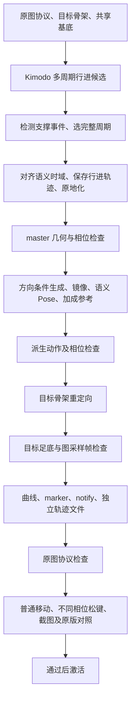

# Kimodo 的 ALS 步态生成约束与分阶段验收

状态：设计契约。三前进试点的生成条件、作者与目标协议门禁、实际起停检查已实现，真实候选尚未通过；实现范围、失败证据和未完成项见 [闭环试验](../verification/2026-10-08-kimodo-gait-closure.md)。它补充 [资源生产设计](kimodo-als-resource-production.md)，优先覆盖普通站立／蹲伏前后左右、斜向、起停，再推广到非道具动作依赖。

依据：[原版 ALS 与当前资源对照](../verification/2026-10-08-als-original-locomotion-analysis.md)、当前 `tools/kimodo_pipeline` 和本机 Kimodo 接口。已确认的问题包括原点残留、支撑曲线编码、同步相位、滑步，以及首帧接触。当前运行／发布状态以 [ROADMAP](../../ROADMAP.md) 为准。

## 1. 让契约同时约束生成、派生与验收

每个资产的合同应包含数值路径、依赖姿态、事件相位、原图采样语义、曲线协议、验收策略，而不只是提示词和 `requires` 文字。生成器读取合同构造 Kimodo 条件；验收器读取原图消费者和独立几何测量，检查生成结果是否满足合同。

| ALS 要求 | 生成阶段的控制 | 生成后的检查 |
| --- | --- | --- |
| 统一身体原点 | 同一 Stand/Crouch 和坐标约定；显式行进路径 | root、pelvis、躯干与公共运动坐标系的偏移；原地化前后可重建一致 |
| 速度与步幅匹配 | 速度用 root2d；节拍与支撑由稀疏姿态条件引导 | 实测周期、行程、步长及支撑期世界足速；重定时后再测 |
| 左右交替支撑 | 已验收的左右支撑姿态、摆动阶段和稀疏脚目标 | heel/toe 接触与离地事件、双支撑／腾空、两侧有效样本及循环闭合 |
| 跨方向同步 | 同组 canonical phase；方向与身体朝向分别控制 | marker 对应同一语义事件，混合后仍能识别左右支撑 |
| 固定 Stop 采样帧 | 时间映射使指定帧落入指定支撑阶段 | 用原图实际帧号采样姿态，并对照 FootPlanted 和原 Stop 规则 |
| 镜像／Pose／additive 依赖 | 从验收后的母动作派生 | 左右语义换边、相位重对齐、参考基底与帧号、混合后的偏移 |
| 正确的运行元数据 | 目标骨架最终时间域上编译曲线、marker、notify | 几何事件、曲线符号／阈值、图读取结果相符，且与最终 raw 同版本 |
| 根运动与距离数据 | 保留行进母本与实际去除的轨迹 | 制作轨迹与最终 root 曲线分别标明来源，时间映射及哈希可追溯 |

这里需要三种不同性质的要求：

- **生成引导**：文本、root2d、fullbody、末端条件。模型及优化器尽量满足，结果必须实测。
- **确定性处理**：坐标转换、事件裁剪、有限重定时、原地化、镜像、加成求差和曲线编码。每次变换都必须保存映射和重新验收。
- **拒绝条件**：原图语义不匹配、缺少支撑、严重滑移、无有效样本、版本／依赖错误。失败资产不进入依赖派生或发布。

## 2. Kimodo 应该收到什么

### 2.1 提示词负责步态和风格

前进 Walk 的提示词示例：

> A person walks forward at a steady pace, taking alternating steps with relaxed arm swings.

侧移使用独立提示词，明确身体仍朝前；后退同理。厘米级原点、原图第 4／21 帧、曲线正负号和 1.5 m/s 等要求进入机器合同及数值条件。提示词不包含 ALS 内部曲线名。

官方建议单段表达一至两个动作、适度细节；单段最长 10 秒，除 dense root path 外每类约束少于 20 个时间点，接触要求高时启用 postprocess。见 [Kimodo 最佳实践](https://research.nvidia.com/labs/sil/projects/kimodo/docs/key_concepts/limitations.html)。这些条件不能代替输出验收。

### 2.2 先生成带行进的母动作

普通直行用 `pXZ(t) = speed × t × direction`，身体 heading 单独固定。当前 ALS 的动画参考速度 1.5／3.5／6.0 m/s 可作为 Walk／Run／Sprint 初始目标。对于每个完整同脚周期，平均速度、周期 T、同脚跨步距离 D 应满足 `D = speed × T`；对称步态的单步距离约为 D/2。

生成时保留真实行进，便于识别支撑期的世界固定脚点。候选长度应容纳起始过渡和至少两个可比较的稳定周期，而不是一律生成 3 秒后固定裁剪。确切时长由步态周期决定，并保持在当前模型范围内。普通起步与稳态循环使用不同的路径和初始状态合同。

SOMA 使用米、Y-up、XZ 地面。当前人物自身左侧为 +X，右侧为 −X；左右由坐标适配器明确转换。`root_positions` 是髋部位置，不能把其 Y 清零作为地面 root。朝向字段是 `[cos(theta), sin(theta)]`。

### 2.3 稀疏姿态约束表达实际支撑

第一次建立 Walk/Run 母动作时，先用统一 Stand/Crouch、文本和数值路径发现候选，检测并验收一个完整周期，再把其中的左右支撑、摆动和同相位边界固化为参考。后续方向／速度变体读取这些已验收的参考，避免要求“先有最终 gait 才能生成第一个 gait”的依赖环。共享的是相位语义和身体基底；各方向的脚锚、步距与腿部姿态需要重新求解，不能将前走全身姿态直接固定到侧移路径上。

一个周期的参考至少区分左支撑、右脚摆动、右支撑、左脚摆动、下一次同脚事件。Walk 允许合理双支撑；Run 可有腾空。事件时长由实际步态和家族合同确定，不能把所有动作的接触占比设为同一常数。

使用少量 fullbody 和具名 `left-foot`／`right-foot` 条件表达这些事件。每次支撑都有自己的世界脚锚；同次支撑期间固定该锚，抬脚后允许移动到下一落点。一个完整行进周期首末应是同相位姿态加上该周期的行进变换，不能固定在同一个世界位置。

本机接口有两个实现细节必须处理：

1. fullbody 的局部轴角用于构造 FK 位置目标，不保证所有局部旋转逐值锁定。足跟、脚尖、朝向和残余 twist 仍需目标骨架检查。
2. foot end-effector 同时携带平滑根位置、髋高度和朝向条件。这些条件必须与 root2d 相容。当前 `materialize_constraints` 只是冻结参考姿态并让 hips 沿路径移动；直接复用它给 gait 加脚条件，会让脚目标跟着身体移动。需要针对“当前 hips + 固定世界脚锚”求出合法参考姿态，再转为 foot 条件；IK 不可达即拒绝该条件组。

Kimodo 当前公开接口没有直接输入 contact pattern 的功能；不能向它传 `FootPlanted` 并期待模型理解 ALS。官方能力边界见 [约束说明](https://research.nvidia.com/labs/sil/projects/kimodo/docs/key_concepts/constraints.html) 和 [JSON 接口](https://research.nvidia.com/labs/sil/projects/kimodo/docs/user_guide/constraints.html)。当前生成已经启用 postprocess，仍须检查后续裁剪、重定时及重定向的结果。

### 2.4 方向、镜像与参考 Pose

前进、后退、侧移各自生成符合方向的母动作；侧移改变数值路径，身体朝向保持前向。后退有自己的着地／推蹬语义。左右成对的对称动作继续程序化镜像，同时交换左右事件、支撑标识、方向及相关 notify。

镜像把左支撑变为右支撑。如果同组要求以左脚事件为 canonical phase，镜像后必须按实测事件确定性循环移相，再同步重排所有曲线和轨迹。移相量由事件决定，不无条件硬编码半周期。

WalkPose/RunPose、Lean 基底、Stop/Jump 参考，从已验收母动作按各自明确语义派生，取代统一 `fraction=.25`。支撑相位参考与低步幅参考是不同角色：后者还要根据 BlendSpace 端点要求调整脚锚／中性姿态，不能把任意单脚支撑帧直接命名为低步幅 Pose。静态 Pose 按原时域重复，仍需验证对应 BlendSpace 端点及加成零差。Idle 相对已验收 Stand 基底生成；起跳读取起跳侧支撑，落地读取接触／缓冲事件，转身与脚距修正读取各自脚锚。

## 3. 生成后应在哪里检查

### A. SOMA 行进候选与原地 master

从足跟／脚尖的高度、水平和竖直速度、最短持续时间、进入／退出滞回推断候选接触，再与预期事件序列核对。单脚最低高度仅可辅助，不能作为唯一接触或 marker 判据。生成曲线不得作为是否抽取滑步样本的唯一依据。

按同一脚的同类事件至下一次同类事件选择完整周期，中间必须包含另一侧的有效支撑。去除起始过渡后比较多个周期；缺少完整周期或接触信号不确定时换候选，不能用尾部强混掩盖缺失步态。

循环检查包含位置、旋转、线速度、角速度及接触状态的周期边界。小幅接缝优化可以使用，但优化后重新检查整个周期；仅首末帧相等不能通过。

确定最终时间映射后，记录实际去除的平滑行进变换 G(t)，并将动作转换到共同原点，保留自然骨盆摆动。需要两项独立检查：

- 用 G(t) 重建行进全身姿态，验证与转换前一致，覆盖裁剪起点常量、朝向和单位。
- 在重建的世界空间测量支撑期足底速度。原地脚本来要相对身体向后移动，不能把这部分局部速度当作滑步。平移情形有 `v_foot_world = v_foot_local + v_actor`；一般情况使用完整变换。

重新定时会改变速度与步幅匹配。保存实际映射及导数，重新计算参考速度和支撑期足速；若满足原图时间要求需要过度压缩某段，应拒绝候选并重生成。不能只改时长而沿用旧速度假设。

### B. 目标骨架和 ALS 图协议

重定向后在目标骨架重测足底、膝关节、骨盆、接触及相位。元数据从**最终姿态与最终时间域**生成。SOMA 通过并不保证目标骨架脚底通过。

`FootPlanted` 的编译应消费明确的支撑阶段：左稳定支撑对应负全值，右稳定支撑对应正全值，准备落脚／过渡使用与原规则匹配的中间值。双支撑、腾空和事件交界按家族处理，不能把 `right_contact - left_contact` 的翻号替换当成完整修复。原版中间值还承载 Plant 与 Lock 的区别。

`FootPlanted`、`FootLock`、同步 marker、脚步 notify 各有用途：前者选择支撑侧与停止策略，脚锁控制世界锚点，同步 marker 对齐相位，notify 表达触地事件。必须分别编译并交叉核验，保持原图所需的曲线存在性与状态覆盖，不能给每个循环都补一组全程脚锁。

对称 Walk/Run 的相反脚事件应接近半周期；容差按原版样本和目标风格形成版本化策略。其他家族不套同一比例。marker 必须落在相应语义事件窗口内，而不是将检测错误的时间强行改成 50%。

原图消费者属于硬接口。前进 Walk 的 Plant Left/Right 使用第 4／21 帧，其他方向有各自固定帧。从原图引用编译 `frame -> expectedSupport` 合同，逐帧检查实际姿态和曲线，并用原停止规则验证选择结果。对时间映射加约束，使这些帧位于正确支撑窗口；若改变图定义，需要独立范围与原生对照验证，不能悄悄放松现有编译断言。

检查器应使用不可被生成器重写的原版协议夹具，结合独立 FK／最终蒙皮几何。生成器与检查器仅复用同一个错误公式会产生自证。

### C. 实际图混合、普通输入与截图

最终验收保留既有完整 71 项、原版同条件足底对照和单／并行一致性。严重滑步拒绝阈值仍为 `max(25 cm/s, 原版同条件中位数 × 2)`，该阈值不是美术合格标准，不因新资源失败而放宽。

在此基础上补足八方向、Walk/Run/Crouch 及步幅端点／中间权重，重点测试不同支撑相位松键。先按均匀相位批量覆盖，再对左右触地、离地和 Plant/Lock 阈值附近自适应加样。每项覆盖起步、稳定移动、减速、停止和重新起步，观察：

- 胶囊位移与物理输出一致；根运动 OFF 没有采样／消费动画根运动；身体局部偏移没有被 IK 隐藏。
- 实际图采样的支撑曲线与左右分支正确，锁脚前后的世界锚点连续，没有另一条来源或混合权重改变语义。
- 最终蒙皮足底滑移、穿地、持续离地及首帧初始化单独检查；有效近地／支撑样本不足时失败。
- 截图附请求帧、实际提交／显示帧、输入状态、相位、曲线、脚锚和包哈希。保存支撑／摆动关键帧及短连续片段；静帧用于姿态，连续轨迹用于滑步。

新增几何／导数阈值应先在原版及明确损坏样本上校准后冻结；不能把未校准阈值标成通过，也不能削弱已有门禁。正例和反例至少包括：符号翻转、幅度缩半、重复同脚 marker、漏一侧支撑、半周期错位、原点偏移数米、镜像不换边、重定时后旧曲线、双脚悬空导致无样本。

## 4. 把检查变成依赖图节点



初始母动作发现与后续依赖生成分为两个阶段。后续方向生成再走同样的周期／检查链，图展开时是新的节点，不回写父 master，保持 DAG 无环。失败的 master 不允许派生 Pose、Lean、镜像或上层资源。

新增检查节点的 receipt 至少绑定：姿态／轨迹／事件哈希、依赖 master 与基底哈希、合同版本、原图协议版本、检查实现与阈值版本、逐项观测值、失败阶段与帧。运行时报告再绑定最终包哈希。已存在的 receipt 依赖失效机制可以复用，但新的 `pass` 必须是实际执行后的结果，不能继续只写 `requires` 文本。

建议阶段为 `detect_gait_events`、`select_cycle`、`canonicalize_phase`、`validate_master`、`derive_support_pose`、`validate_target`、`compile_als_events`、`validate_als_contract`。当前三前进试点将作者检测／选择／检查合并在 `gait_cycle` 操作内，目标协议检查由 publisher 执行；这些设计名称并非全部是现有 CLI 操作。

示例为建议的作者合同片段，不是可直接传给 Kimodo 或当前 runner 的 JSON：

```json
{
  "status": "proposed",
  "semantic": "Walk_Forward",
  "movement": {"mode": "in_place", "authoredSpeedMps": 1.5},
  "canonicalPhase": {"anchor": "left_contact", "requiresBothSides": true},
  "targetTiming": {"fps": 30, "sampledKeyCount": 35},
  "graphConsumers": {
    "edition": "refactored",
    "stopSamples": [
      {"frame": 4, "support": "left_stable"},
      {"frame": 21, "support": "right_stable"}
    ]
  },
  "curveProtocol": {
    "FootPlanted": {"leftStable": -1, "rightStable": 1}
  },
  "requiredReceipts": [
    "master_geometry", "cycle_continuity", "target_support",
    "als_graph_contract", "ordinary_movement_release"
  ]
}
```

生产合同还需包含各方向完整固定帧、过渡阶段、循环重复端点约定、时间映射限制及已校准质量策略，不能仅凭以上片段发布。

## 5. 距离曲线贯穿生产过程

保留两种不同来源的文件：

- **制作行进轨迹**：普通步态原地化时去除的 G(t)，含位移、累计路径距离、时间映射和语义相位。用于重建行进、速度校准及未来 distance matching 数据制作。
- **最终 root 轨迹**：继续使用现有 `root_curves.py`，从目标 raw 的最终 root 骨烘焙，反映运行资产实际 root 运动；每个含根运动的资产独立输出。

普通原地循环的最终 root 为零，现有 baker 不会保存之前去除的行进量，因此需要增加第一种文件。它不能冒充运行时已提取的 root motion。两类文件都必须匹配最终时间域、方向／单位和资产哈希。裁剪、镜像、循环移相、重定时先传播到轨迹，再生成距离；周期轨迹需要记录每圈行程与累计展开规则，不能在移相处制造一段虚假跳跃距离。

检查累计距离单调、终点距离一致、速度积分一致、镜像距离保持且方向正确，以及重定时后的时间对应。当前 root-motion 开关保持作为运行策略；有文件不表示 Distance Matching 已接入。

## 6. 当前代码与实施顺序

| 位置 | 当前行为 | 所需改动 |
| --- | --- | --- |
| `graph.py` 的 gait generate | 路径 + 首帧 Stand/Crouch，无步态脚锚 | 读取验收参考和事件合同，生成相容的 sparse pose/foot 条件 |
| `motion.py:materialize_constraints` | 冻结参考姿态并移动 hips | 为支撑区间构造可达的世界脚锚姿态，检查条件冲突 |
| `graph.py` 的 loop/Pose | 固定 35% 裁剪、25% 抽帧 | 基于接触事件选周期／语义帧，受原图消费者约束 |
| `motion.py:loop_candidate` | 去行进与尾部混合 | 保存轨迹、导数与接触连续性验收，拒绝失败周期 |
| `runner.py:deliver` | 重采样，写入 `requires` | 要求上游真实检查 receipt，重采样后重新验证 |
| `publish.py:contact_data/curve_values` | 高度包络、argmin marker、错误半幅符号 | 语义事件编译与独立原规则验证 |
| `root_curves.py` | 最终 target root 独立 sidecar | 保留，并增加独立的制作轨迹产物及时间映射校验 |
| 发布与 E2E | 71 项及足底质量门禁 | 保留，扩展相位化起停和混合检查，不放宽阈值 |

实施先做可快速拒绝当前坏样本的原协议／支撑检查，并修复已确认的编码错误；再改事件选周期与生成条件。先完成 Walk Forward、Run Forward、Crouch Forward 的小闭环，使独立姿态、派生 Pose、原图混合和松键全部通过，之后扩大到方向、镜像及其他非道具依赖。每个候选保留模型／seed／约束／后处理配置和失败原因，使用有限候选预算；没有合格母动作时阻断依赖生产。

新增控制是否改善输出，需要实际生成和目标骨架／普通 Demo 验证；不能从条件可达或单元测试推断质量。当前试点已执行真实生成但被作者门禁拒绝，详见本页开头链接；尚无新包质量通过的结论。
