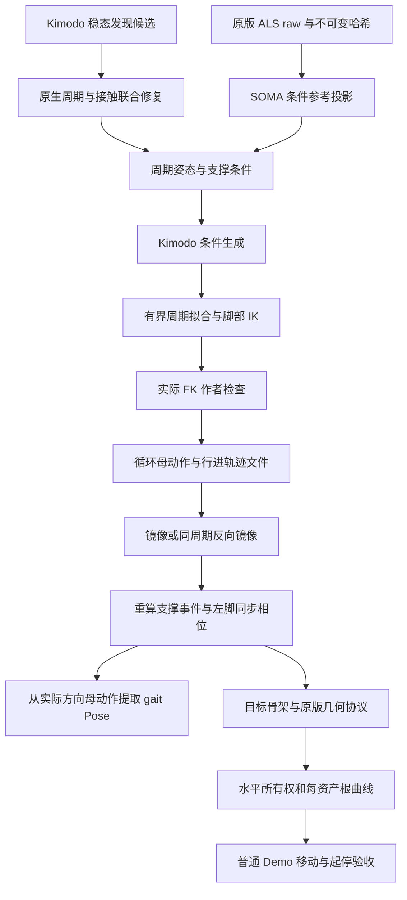

# Kimodo 侧向步态与 Sprint 加速的生成合同

本合同对应 `tools/kimodo_pipeline/directional_gait_rules.json`。它修订方向、提示词、参考姿态、周期条件和程序化派生；最终 Godot 替换仍须经过目标骨架及运行验收。[本批结果](../verification/2026-10-09-kimodo-directional-gait-regeneration.md)记录生成成功与被拒绝的动作。

## 原版资产用途

`Left_Forward` 与 `Left_Backward` 都是向左横移。Forward/Backward 区别在于髋部朝向及迈步姿态，不能把它们的 root 路径设置成左前／左后对角线。右侧是对应的镜像。作者坐标为 SOMA 米、Y-up、角色前方 +Z；左移为 +X，右移为 −X。

`Sprint_Acceleration` 是 Movement 同步组内的循环动作；V4 对应 `ALS_N_Sprint_F_Impulse`。它表达持续冲刺中的前倾／发力，不能生成反复从 Idle 起跑的片段。原版该片段的支撑足速约 5 m/s，普通 Sprint 约 6 m/s；前者播放器的 `playRateBasis` 约 0.833。参考事实来自原始 raw 数据、source bindings 与 `v4_locomotion_source_graph.json`，不修改普通角色的移动速度设置。

| 语义母动作 | 路径与参考朝向 | 原生周期 | 生产方式 |
| --- | --- | --- | --- |
| Walk_Left_Forward | +X，髋部约 +45° | 34/30 s | 稳态走路发现候选 → 有界周期修复 → 条件再生成 |
| Walk_Left_Backward | +X，髋部约 −45° | 34/30 s | 对 Left_Forward 的完整行进周期反向播放并左右反射，再测事件 |
| Run_Left_Forward | +X，髋部约 +45° | 24/30 s | 原版姿态投影作条件参考 → 稳态跑步生成 |
| Run_Left_Backward | +X，髋部约 −45° | 20/30 s | 独立生成；原生周期不同，禁止直接反向复制前向变体 |
| Crouch_Walk_Left_Forward | +X，髋部约 +45° | 34/30 s | 蹲姿稳态走路发现／修复／再生成 |
| Crouch_Walk_Left_Backward | +X，髋部约 −45° | 34/30 s | 同周期前向变体反向播放并反射，再测事件 |
| Sprint_Acceleration | +Z，约 5 m/s | 18/30 s | 移动参考依赖和原版周期姿态条件 → 持续前倾冲刺生成 |
| 各 Right 变体 | 对应 −X，髋部朝向反射 | 与对应 Left 相同 | 只从通过检查的 Left 母动作派生 |

配置中的英文提示词描述持续动作、稳定节奏和髋部／胸部关系。速度、路径、朝向、节奏、支撑和闭环分别使用数值条件，不依靠文字中的 “loop” 实现。

## 条件与依赖

`als_reference.py` 用纯脚本把原版全局旋转变化与足底方向／脚趾位置投影到 SOMA，通过固定骨长腿 IK 形成生成参考。参考输出明确标记 `constraint_reference_only`、`deliverable=false`，不作为新资产交付。索引、原始 payload 与代码均进入执行身份；路径越界或原文件摘要改变会拒绝执行。

发现候选保留较长观察窗口。再生成窗口覆盖至少三个原生周期，整段使用等速 root2d 路径。全身姿态在周期边界、边界邻域及连续三个周期的约 1/4、1/2、3/4 位置重复约束。最后一帧使用它自己的真实相位，非整数周期结尾不会强行换成 phase 0。

支撑条件来自实际检测的参考区间，在同一支撑区间内固定世界空间脚锚和足部朝向。配置支持多个区间内锚点；每种稀疏条件最多 19 帧。足部可达性、共享髋高、路径／朝向一致性及配置的 15 cm 脚锚改变量在生成前检查。步幅随目标周期调整，不能只改变时间轴。

Kimodo 的全身条件主要约束关节位置；跑步及 Sprint 另加左右手末端旋转条件，减少周期边界的手腕方向差异。手部条件和足部条件共用已解算的姿态／根位置，避免相互矛盾。该接口能力来自当前 Kimodo `constraints.py`，全身条件不等同于逐骨旋转锁定。

## 修复与派生的边界

周期修复可以使用明确的受约束周期窗口与独立参考触地计划。窗口两端必须匹配实际输出几何，参考必须有真实交替支撑；修复后重新测量输出足底，参考接触标记不能替代输出验收。傅里叶拟合、固定骨长 IK、足底穿地校正和可选膝部弯曲余量均保存过程记录。默认修复限额保持：脚锚校正相对周期拟合结果不超过 15 cm、IK 髋部降低不超过 5 cm、周期拟合相对原输入的旋转改变量不超过 20°。这些是各步骤的限额，不是最终姿态相对原输入的累计限额；既有接缝、滑步与周期验收阈值不放宽。

镜像需要同时反射身体和被移除的行进轨迹。反向镜像也先恢复完整行进坐标，反向时间后再反射。派生动作重新检测触地／离地，裁取新左脚到左脚周期并重新写曲线；不能复制原左脚标记或假定平移半周期就完成了同步。必要时对派生周期再次执行有界修复，失败仍阻断下游。

经过验收的矩阵在 NPZ 保存／读取后保持原值。只有存在可测非正交误差的原始矩阵才投影到 SO(3)，避免反复数值归一化使已执行的验收摘要失效。母动作被实际修改时仍拒绝派生。

对于本配置覆盖的 gait Pose，右侧静态参考从实际右侧母动作提取，保证它与重新测量后的右侧相位及目标原点一致。

## 目标骨架与发布

目标检查已扩展到原版侧移和加速身份。站立／蹲姿走路和前向侧跑按原版足底支撑校准；后向侧跑采用原版脚趾支撑，Sprint 加速采用前脚掌支撑。新的方向检查使用对应原版数据校准，原三个前进试点的阈值保持原有值。侧移速度沿 X 重建，不能继续套用前向 Y 速度。

作者 NPZ 与 `authoring-trajectory.json` 是源资产产物。实际 root 曲线仍在最终目标资产发布时按 [根运动合同](als-root-motion-policy.md) 和 [水平所有权合同](kimodo-planar-root-ownership.md) 烘焙；两者用途不同。作者检查通过不代表目标蒙皮、原版固定帧消费者、Godot 正常移动或人工观感已通过。
