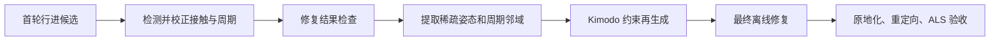

# Kimodo 周期动作：离线修复、关键帧回灌与再生成

目标是让离线修复结果成为数值条件，供 Kimodo 补全自然过渡，再做最终确定性校正。上一批仅从未验收的候选抽取参考，并约束周期单帧姿态，三个新母动作仍失败；见 [闭环试验](../verification/2026-10-08-kimodo-gait-closure.md)。

当前已增加确定性周期修复后端，并完成前进 Walk 的真实修复／回灌／目标骨架／普通起停闭环；其余方向和完整非道具验收未完成。最新实施与边界见 [周期修复与 Walk 闭环](../verification/2026-10-08-periodic-repair-feedback.md)。下文原生 MotionCorrection 首次试验的失败仍保留，不能替代最新周期后端结果；Blender 后端尚未实现。

## 1. 从 Kimodo 的原理确定分工

Kimodo 在扩散去噪中使用运动条件，并把平滑根轨迹与身体预测分开处理。数值条件能指定路径、关键姿态和末端目标，但不等于各帧都满足完整接触动力学。fullbody 主要约束关节位置，末端条件可含位置／旋转；生成之后仍需要确定性校正。依据：[论文](https://arxiv.org/html/2603.15546)、[官方约束说明](https://research.nvidia.com/labs/sil/projects/kimodo/docs/key_concepts/constraints.html)。

因此采用：



修复结果 B 应独立保存。再生成 E 会改变非约束帧，可能重新引入滑步；只有在自然性和硬检查同时满足时才接受。如果再生成及最终修复不优于 B，应保留较好的合格版本，而不是无条件覆盖或无限循环。

## 2. 周期边界应约束姿态和运动趋势

对于带行进的直线步态，设周期 T、每周期位移 D，应满足局部姿态重复，而全局位置相差 D。不能把世界空间首末位置锁成同一个点。

```text
局部姿态 q(T) ≈ q(0)
全局位置 p(T) ≈ p(0) + D
线速度／角速度在周期边界连续
```

先按左右支撑事件找周期，再联合拟合或优化闭合边界。对首末若干帧使用周期样条／周期优化，把根残差和局部旋转差分连续性纳入目标；保留旋转群上的正确表示，避免直接平滑 Euler 角。接触与周期目标需要联合求解或交替求解后复验，防止修接缝破坏锁脚、修锁脚又破坏接缝。

回灌时建议生成约三个周期，在中间周期边界放置 `T-dt、T、T+dt` 等匹配邻域，并重复到下一边界。它让模型看到穿过边界的运动趋势，比只给一张相同端点姿态更充分；这不是 Kimodo 原生速度约束，也不保证严格 C1。取中间周期后仍须测姿态、线速度、角速度和接触连续性。

当前 `boundaryContextFrames=1` 已加入 `gait_constraints.py` 和三前进试点规则。内部周期边界前后各一帧，循环脚锚仍只按真正周期创建；每类 sparse 条件继续少于 20 帧。生成效果尚未实测，不据条件构造测试宣称改善。

周期、速度、步长必须相容。优先保留候选自然节拍，再确定 ALS 时间映射与目标骨架的动画参考速度；重定时后重新验证足部速度，不能同时任意指定互不相容的周期和行进速度。

## 3. 离线滑步修复的约束

在有行进的空间中修复。对原地动作先加回已保存的制作轨迹，修复后再减去同一条轨迹；直接把原地动画的脚局部后移锁成零，会破坏正常步态。

接触计划区分 heel strike、flat support、toe off、swing，结合模型接触预测、几何高度、竖直运动、持续时间和左右事件顺序。正在滑动的脚可能速度较高，不能因为高速度就删除所有接触样本；模糊区间应保留不确定性，允许在 Blender 中修正标注。

对每个支撑区间建立世界锚点：平脚时控制足底位置／方向，抬跟阶段允许绕脚尖滚动，摆动阶段释放约束。过渡权重平滑变化，膝 pole 和骨长保持，双脚同时支撑时联合处理有限骨盆补偿。控制角色整体轨迹、姿态改变量、关节极限和不可达目标；不能以拉长腿或大幅修改行进路径来隐藏滑步。

检查器独立测足部几何，输出支撑期滑移、穿地、膝跳变、骨盆改变量、步幅／速度和周期接缝。修复不能仅以一个滑步均值下降判定成功。

## 4. 开源实现核查

| 项目 | 源码确认的能力 | 适用判断 |
| --- | --- | --- |
| [Kimodo MotionCorrection](https://github.com/nv-tlabs/kimodo/tree/main/MotionCorrection) | 独立 C++ 轨迹／IK 校正，Python bindings，Apache-2.0 文件头 | 最适合先在 SOMA 空间复用，已经安装；仍需接触计划与显式周期约束 |
| [Blender Mocap Tools](https://github.com/blender/blender-addons-contrib/tree/main/mocap) | point／freeze／floor／distance 约束、区间权重和烘焙；GPL-2.0-or-later 文件头 | 可参考其 Blender 编辑／烘焙流程；代码存在旧 API，未验证现代 Blender 兼容性 |
| [NoSlide](https://github.com/grgr/no_slide) | 用指定支撑区间／网格顶点推导对象的平移和旋转；声明 Blender 2.7.1 | 主要修正对象行进，不是完整的腿部周期 IK 修复器；不能直接当 ALS 原地脚步修复后端 |
| [Rokoko Blender 插件](https://github.com/Rokoko/rokoko-studio-live-blender) | 官方说明确认流式数据与重定向 | 没有据此确认 Studio 的完整 foot-lock 求解器可由该开源插件独立调用 |

Blender 源码可确认 visual baking 会采样约束生效后的变换：[NLA bake 实现](https://github.com/blender/blender/blob/main/scripts/startup/bl_operators/anim.py)。建议用当前版本 `bpy` 的 IK、pole、脚部旋转约束和 visual bake 制作可控后端，旧插件作为设计参考。不要把可见代码或 README 功能列表当成本项目已经完成兼容验证。

已保存 NoSlide、Mocap Tools 和 Rokoko 的固定提交来源、相关文件及 SHA256：[调研来源](../../artifacts/research/2026-10-08-foot-slide-repair/sources.json)。GitHub API 遇到公开限流后改用公开 Git HEAD 和固定提交 raw 文件读取，没有执行下载的插件代码。

## 5. Blender 后端与回灌的数据边界

优先在同一 SOMA 骨架上修复，保留人物的局部旋转、髋位置、单位、FPS 和关节顺序，再输出原生 NPZ 供 Kimodo 使用。Blender 世界通常 Z-up，Kimodo 为 Y-up／米制；转换必须有 FK 往返误差检查。Blender 的骨骼 rest basis／roll 与 SOMA 局部坐标不等价，不能直接把 PoseBone quaternion 写进 Kimodo。

Blender 可视化后端的预期步骤为：导入到隔离场景 → 建立足底／地面及世界脚锚 → 两段腿 IK 与 knee pole → 限制骨盆改动并联合处理双支撑 → 周期边界优化 → visual bake 到新 Action → 重采样为 SOMA NPZ → FK 和接触复核。此后提取稀疏中段支撑／摆动关键帧及周期邻域供再生成。

最终 ALS 重定向仍可能引入新滑移，因此源骨架修复和最终目标蒙皮修复是两个独立检查阶段。不要把 ALS 上的修复姿态直接当成 SOMA 数值条件；反向适配未验证时，应保留 SOMA 修复分支作为回灌源。

## 6. 本批新增的可执行入口与结果

新增 [offline_repair.py](../../tools/kimodo_pipeline/offline_repair.py)，使用安装的原生 MotionCorrection；**不是已经实现的 Blender 后端**。

现也支持 `--backend periodic --harmonics 4`：全周期拟合与世界脚锚 IK 联合处理，保留骨长、限定位姿修正；适用于明确的行进输入。`gait_repair_feedback_rules.json` 将参考修复、再生成、合格候选选择和母动作检查接入 DAG。正向 Walk 已实测通过，详见本页开头的最新验证记录。

```powershell
python -m tools.kimodo_pipeline.offline_repair `
  --input generated.npz --rig rig.json --kimodo-repo G:/Github/kimodo `
  --space travelling --speed 1.5 --feedback --output <新的输出目录>
```

输入必须声明 travelling／in-place。原地输入要求额外提供 `--trajectory`；接触可以来自原生 `foot_contacts` 或 `--contacts` 的显式四路计划。输出保留 `repaired.npz` 和修复前后独立报告；只有作者检查通过，`--feedback` 才能导出带周期邻域的再生成条件。它不是完整的周期联合优化器，也不负责激活资源包。

本次发现一个已存在于旧离线实验探针的接口错误：SOMA77 扩展接触有六路 `[Lheel,Ltoe,LtoeEnd,Rheel,Rtoe,RtoeEnd]`，本机 C++ 接口却按 `4*frame+channel` 读四路。新入口显式转换成 `[Lheel,Ltoe,Rheel,Rtoe]`；如果六路不是原生 toe 重复布局，要求提供明确计划，不能静默丢弃独立信息。正常 Kimodo 生成在 SOMA30 四路阶段处理，不把此错误误归因于所有正常生成。

真实新 Walk 的离线试验完成：全片近地足部代理速度中位数左脚约 13.15 → 12.87 cm/s，右脚约 16.31 → 16.24 cm/s；骨盆最大改动约 4.65 cm。滑移略降，但接缝检查变差，仍然 `repair_rejected`，没有作为合格参考再次生成。见 [修复报告](../../artifacts/research/2026-10-08-foot-slide-repair/walk-native-repair/repair-report.json)。这些是 SOMA 代理指标，不是 Godot 蒙皮结果。

本批 83 项 Python 回归通过。三动作的邻域条件均通过实际 Kimodo SOMA30 parser：fullbody 时间点分别为 Walk 11、Run 17、Crouch 11，每类 sparse 条件均少于 20，路径误差为 0；这只验证条件格式和一致性，见 [解析报告](../../artifacts/research/2026-10-08-foot-slide-repair/boundary-parser-report.json)。未运行 Blender 插件或新一轮 Kimodo 反馈生成。下一步应在同一 Walk 上加入经过审查的接触计划和周期联合修复，对比原始 A、修复 B、回灌生成 C、最终修复 D；全部门禁保持，不用修复次数或提示词变化代替质量证据。
