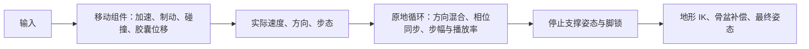

# 原版 ALS 的普通移动、停止与资产契约

本次核对项目保存的 ALS V4 原始导出、ALS-Refactored 原始动画／蓝图导出，以及项目锁定的 Sixze 原生源码。普通走跑采用“胶囊移动 + 原地步态 + 相位同步 + 步幅／播放率匹配 + 停止支撑／脚锁 + 地形 IK”。替换资源需要满足这一整套配合关系。

## 依据与边界

- 原生源码固定为 [锁文件](../../reference/als-refactored.lock.json) 的 `b754d6f0f2bb03741d301f8fb88077ebfe561e17`，不使用网页当前主分支代替项目版本。
- [原生源码快照及哈希](../../artifacts/tests/2026-10-08-als-original-analysis/reference-source.json)：来自作者仓库的五份源文件，只读下载。
- [资产审计脚本](../../artifacts/tests/2026-10-08-als-original-analysis/audit_original_assets.py) 和 [完整结果](../../artifacts/tests/2026-10-08-als-original-analysis/original-assets-audit.json)：核对原版、当前 v8、未激活 v11 的选定资产、相位、配置与原版停止图；payload 匹配各自索引哈希，51 个读取文件在审计前后字节不变。
- 本次为原始导出与源码分析；没有重新启动 Unreal Editor、执行新 E2E 或改变活动资源。上一批真实运行的证据与失败边界仍见 [移动与松键诊断](2026-10-08-als-movement-release-diagnosis.md)。

## 普通移动的工作顺序



胶囊位置由移动组件更新，动画再读取实际速度。松键后仍有制动阶段；速度、碰撞后的实际位移和动画显示需要分别观察。角色能移动多远，不由普通走跑序列的 pelvis 轨迹决定。原生移动参数入口为 [RefreshGaitSettings](https://github.com/Sixze/ALS-Refactored/blob/b754d6f0f2bb03741d301f8fb88077ebfe561e17/Source/ALS/Private/AlsCharacterMovementComponent.cpp#L903)。

原地步态仍有腿部前后摆动、骨盆上下起伏及小幅水平摆动。在支撑阶段，脚相对身体的后移配合胶囊前进，才得到接近静止的世界足底。冻结 pelvis 会抹掉这些必要运动；仅冻结新增的 root 骨也不会消除错误写在 pelvis 上的整体位移。

原版不是简单地把几个各自生成的动作按方向相加：六个方向源、Walk/Run、Stride 端点与加成基底共享相位和坐标约定。停止图还直接读取某些 Walk 帧。这些依赖意味着一条动画在独立预览中正常，并不保证接入整图后正常。

## 步幅与播放率

原版导出配置中的动画参考速度为 Walk 150、Run 350、Sprint 600 cm/s，Crouch 150 cm/s。它们是匹配动画用的校准值，不是当前 Godot HUD 或每种角色配置的最高速度。

原生 [RefreshStandingMovement](https://github.com/Sixze/ALS-Refactored/blob/b754d6f0f2bb03741d301f8fb88077ebfe561e17/Source/ALS/Private/AlsAnimationInstance.cpp#L985) 用实际速度查 Walk/Run 的 Stride 曲线，并结合 `PoseGait` 计算播放率。近似关系为：

```text
播放率 ≈ 实际速度 / 动画参考速度 / 步幅缩放
```

实际公式按混合姿态在 Walk/Run/Sprint 之间插值，并考虑角色缩放。步幅控制脚的运动距离，播放率控制运动频率。新资产若与原版参考速度、步幅响应不匹配，需要重新校准并验证世界足底滑移，不能仅保留原参数就认定匹配。

原版这条普通路径没有按“预测剩余停止距离”驱动动画时间；独立烘焙的距离曲线可以供以后 Distance Matching 使用，当前不会自动修复步态或支撑相位。

## 松键之后的停止处理

以下是 **ALS-Refactored** 原版图的具体机制，V4 的停止通知／动画路径单独说明。

`bMovingSmooth` 同时考虑输入与实际速度。完全进入 Move 后停止，进入嵌套 Stop 图；尚未完全进入 Move 的短促输入另有 Move → Idle 路径。原始配置的 Move → Stop 混合为 0，Stop → Idle 为 0.3 s，短促 Move → Idle 为 0.2 s。

Stop 的 Entry 按 `FootPlanted` 与优先级选择：

| 条件（从上到下） | 状态 | 动作 |
| --- | --- | --- |
| `> 0.5` | Lock Right Foot | 延续 Movement Details，右脚锁曲线置 1 |
| `<= -0.5` | Lock Left Foot | 延续 Movement Details，左脚锁曲线置 1 |
| `> 0` | Plant Right Foot | 对右腿叠加固定支撑姿态，右脚锁曲线置 1 |
| 其余 | Plant Left Foot | 对左腿叠加固定支撑姿态，左脚锁曲线置 1 |

Plant 姿态来自 **Walk 序列的固定帧**，不是独立播放一条通用 Stop 动画。前进 Walk 的左脚 Plant 读第 4 帧，右脚 Plant 读第 21 帧；其他方向各有固定帧。图只替换对应腿、IK 脚及虚拟脚分支，不修改 root。

这给替换资产增加了明确约束：第 4／21 帧必须仍具有图所期待的支撑语义。若生成周期的相位被任意平移或重采样，即使保留名称和帧数，原图也会采到错误姿态。完整六方向采样帧已写入本批 JSON 的 `originalStopGraph`。

各 Lock／Plant 状态还具有左右停止过渡的入态回调。Quick Stop、Dynamic Transition 与上述固定腿姿态分别承担不同职责；不要把它们全部当成同一条“松键立即播放 Stop”路径。

## 脚锁为何要求正确的历史姿态

Refactored 的 [RefreshFootLock](https://github.com/Sixze/ALS-Refactored/blob/b754d6f0f2bb03741d301f8fb88077ebfe561e17/Source/ALS/Private/AlsAnimationInstance.cpp#L1395) 在移动时主动降低锁权重；锁权重升到全权重时，通常以**上一帧脚锁混合后的、尚未施加地形 IK 的脚变换**捕获新锚点，避免切换时跳脚。随后维护世界／移动平台锚点，再转换到当前组件空间供 IK 使用。

因此脚锁不能修正整个人体偏离胶囊几米的输入姿态。上一帧脚位置已经错误时，它会保留错误坐标；身体混回正常 Idle 后，腿被拉向远处锚点。本次 v8 的停止折腿与这一机制吻合，真实逐帧证据见前一批诊断。

原版另有 Dynamic Transition：允许过渡时，比较目标脚与锁点的距离，本配置阈值为 8 cm，选相应脚做小幅重新落脚。地形 IK／骨盆补偿负责接触地面和腿部可达性，不能代替资产原点及步态语义校验。

**V4 的实现有区别**：原始 `SetFootLocking` 在全锁阈值 0.99 时每次更新都捕获当前脚的组件空间变换，再由 `SetFootLockOffsets` 用速度 × dt 和旋转差补偿；不能套用 Refactored 的“只在升到全锁时捕获上一帧 Final”规则。V4 原始图位于 `v4_foot_ik_inputs.json`，本批审计也记录了这两个函数及阈值。两版共通的前提仍是正确的局部姿态、支撑曲线和空间转换。

## 原版数据与替换包的差异

下表是原始导出中 pelvis **局部水平位置到原点的最大距离**，单位 cm，不是世界累计位移。所有这些普通移动资产的 root 水平位置均为 0，且 `enableRootMotion=false`。

| 资产 | 原版 | 当前 v8 | 候选 v11 |
| --- | ---: | ---: | ---: |
| Walk Forward | 3.899 | 150.796 | 6.136 |
| Run Forward | 5.330 | 352.504 | 5.942 |
| Run Forward Pose | 3.257 | 350.304 | 4.601 |
| Sprint | 2.573 | 603.980 | 5.981 |
| Sprint Acceleration | 9.926 | 849.982 | 5.638 |

本批 V4 的 Walk/Run/Sprint 原始导出也得到同样的原版 pelvis 范围。v8 的大偏移已经存在于 raw 数据中；它不需要动画 root motion 生效就能让网格离开胶囊。v11 消除了这一量级的偏移，尚未解决全部足部质量问题。

| 左右标记的循环时间间隔 | 原版 | v8 / v11 |
| --- | --- | --- |
| Walk Forward | 50% / 50% | 2.94% / 97.06% |
| Run Forward | 50% / 50% | 20.83% / 79.17% |

生成包没有沿用原版左右交替的时间关系，且 v11 保留了该问题。这是跨方向／步态同步与固定帧采样的风险证据，不能据此独立量化全部滑步。修复时应先确认真实足部接触与支撑，再生成相符的 marker、支撑曲线和固定采样姿态。

## 补充核对：生成支撑曲线的符号与幅度错误

沿发布脚本继续核对，确认 v8 与 v11 的 `FootPlanted` 均严格来自 `0.5 × (左脚高度包络 − 右脚高度包络)`，范围为 −0.5～+0.5。原版曲线达到 −1／+1，负值对应左脚，正值对应右脚。生成公式的符号相反，且缩小了幅度；单靠这些循环的曲线达不到原停止图右脚 Lock 的 `> 0.5` 阈值。

| 前进 Walk 固定帧 | 原版曲线／按原规则选择 | v8、v11 曲线／按原规则选择 |
| --- | --- | --- |
| 第 4 帧，左脚较低 | −1 → Lock Left | 约 +0.470 → Plant Right |
| 第 21 帧，右脚较低 | +1 → Lock Right | 约 −0.434 → Plant Left |

原版和生成 Walk 在这两个固定帧仍保留左脚较低／右脚较低的关系；本次证明的是曲线编码与原停止图不匹配，不能把此前固定采样帧的风险表述当成这两个帧的姿态已经选错。表内状态是对原规则的静态推导，不是新采集的运行状态。原版完整曲线还区分部分支撑与完全支撑，这也需要按真实步态重建。

发布脚本的 `contact_data` 仅以每脚高度的第 10 百分位作为基准，按 3.5 cm 高差生成包络，并将全周期最低高度帧作为 marker。它没有联合验证支撑期足部水平速度、左右交替和足底接触，所以“脚比较低”会被当作支撑，不能证明脚在世界空间稳定。

见 [独立复核脚本](../../artifacts/tests/2026-10-08-als-original-analysis/audit_support_encoding.py)、[数据与原规则推导](../../artifacts/tests/2026-10-08-als-original-analysis/support-encoding-audit.json)、[发布公式](../../tools/kimodo_pipeline/publish.py#L129) 和 [停止规则](../../src/Als.Core/Locomotion/AlsRefactoredStopRule.cs)。脚本对生成 Walk/Run 的公式复算误差为 0，读取文件未改变；本批仍没有修改生成公式或重新验收运行。原始足骨高度仅用于姿态对照，不作为最终足底离地高度。

另外，“原版 ALS 全部没有根运动”并不准确：本批原版 Roll 明确 `enableRootMotion=true`，root 水平轨迹可达 275 cm；Mantle High 有 root 轨迹、`forceRootLock=true`，但序列的 `enableRootMotion=false`。特殊动作的运动方式应按对应动作路径和元数据处理，普通走跑的原地约定不能覆盖所有动作。

## 生产依赖图需要落实的约束

1. 统一参考姿态和局部坐标。原版 Idle 是相对 `A_Als_Stand_Pose` 的局部空间 additive；生成 Idle／上身变化时必须保留这个基底关系。
2. 先验收完整循环 master：左右交替支撑、摆腿、真实步幅、循环首尾与身体局部范围；整体行进轨迹与自然 pelvis 摆动分开处理。
3. 从已验收 master 统一派生方向、镜像、Stride Pose 及相关加成。左右镜像同时交换脚语义、marker 和支撑曲线。
4. 用实际支撑阶段生成同步标记与 `FootPlanted`／V4 `Feet_Position`，并验证原图固定 Plant 帧。曲线名称一致不足以证明语义一致。
5. 校准动画参考速度、步幅响应和播放率；执行前后左右、斜向、不同松键相位及起停测试，同时检查胶囊积分、网格原点、脚锁历史和足底滑移。
6. 按已批准的根运动策略独立烘焙轨迹／距离曲线；将它们作为未来控制输入保存。发布仍须通过现有质量门禁，不能通过本次静态审计替代运行验收。

以上补充了既有 [Kimodo 生产设计](../architecture/kimodo-als-resource-production.md) 的原版依据；本批没有改写生产图、生成资源或激活 v11。
