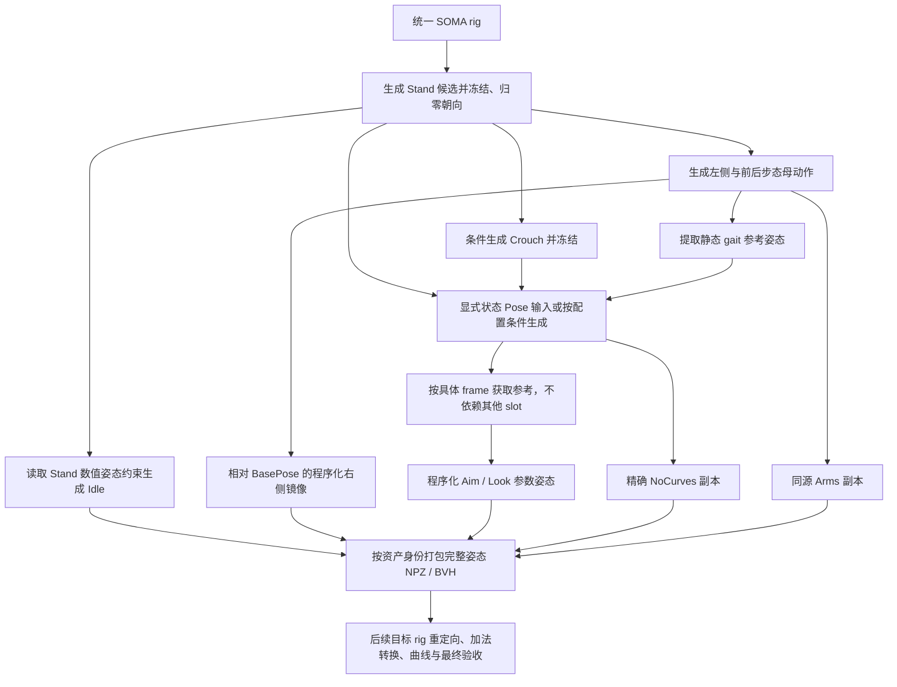

# ALS 资源生产依赖图

跑步使用 `run --scope run` 和 `run_rules.json`，只补六个 Run 循环／十二个身份，复用既有生成、左右派生与完整交付阶段。`--base-pack` 保留已完成资产；有界接触计划延长仍须通过原实际输出门禁。见[跑步范围与修复合同](../../docs/architecture/kimodo-run-pipeline.md)。

下落制作使用独立 `air.py` / `air_rules.json`，入口 `python tools/produce_als_resources.py inspect|plan|run --scope air` 或 `scripts/produce-air-als.ps1`。当前覆盖 Fall / Fall_Fast / Flail 和 Air Lean，共 16 个身份；专用三维髋部条件、有界周期制作、源／目标检查与交付回执并行于平面移动和 Mantle，复用共用转换／FBX／Godot 阶段。详细契约见[独立 Air pipeline](../../docs/architecture/kimodo-air-pipeline.md)。独立包仍诊断、全量生产门禁保持，默认指针不自动切换。

Mantle 在 `publish stage` 中额外烘焙逐 sequence 的前移／抬升、剩余高度、双手独立接触权重、固定 ledge 局部 wrist 位置和 palm 朝向，并登记配置 payload。High 的前移按最终目标蒙皮与台沿模板延后，避免身体尚未越过台面就前移；它保留原落点，不改写 Root/Pelvis。具体计算与配套消费要求见[固定支撑及双向交付契约](../../docs/architecture/als-mantle-contact-control.md)。

**生产端必须导出，导入项目必须识别。** 正式包交付 `config/refactored_mantle_contacts.json` 并登记文件 SHA256；导入项目须核对版本、最终姿态／Root 摘要、sequence 和时间轴，实际应用其中的 `advanceCm`、独立抬升及手部接触控制。只交付／导入 FBX 或 Root sidecar 不满足此合同。当前 Godot ALS 通过 `AlsMantlingDemoResources` → `AlsMantlingContactCompiler` → Core 进度／手部控制消费；其他项目需实现等价路径或显式报告不支持，不能以普通动画导入成功代替曲线验收。

导出自动写入 `mantle-curve-semantics-v1`：键值中的 `rootAdvanceCm` 独立保留修正前 Root 前移，`advanceCm` 用作时间驱动的避障控制；`curveAnalysis` 记录前移平台段，`curveContract`／包的 `mantleCurveContract` 声明实际用途和消费要求。当前高度入口匹配为 true，持续距离驱动播放、整段前移距离反查和 Root Motion Warping／窗口导出为 false。烘焙、stage、正式启用和完整运行前均校验，错误声明或把避障值冒充原始距离会失败；运行前保留失败证据。仅有非递减曲线不能证明完整 Distance Matching／Warping 已实现。见[固化判断与数据契约](../../docs/architecture/als-mantle-contact-control.md#distance-matching-与-motion-warping-的导出判断)。旧包继续保持原字节，新 Pipeline 要求新版本合同。

既有诊断包可用 `python -m tools.kimodo_pipeline.mantle_contacts --config <选中包/config>` 补烘焙到按输入 SHA 命名的独立目录，不重写动画／FBX／包清单；原版对照需同时对 `assets/config` 烘焙。完整接触路径优先读取包内曲线，再查匹配摘要的补烘焙；均缺失或数据不匹配时失败。诊断补烘焙不能代替正式随包交付。

完整 pipeline 对含生成 Mantle 的包，在通用 E2E 后自动运行静态支撑／全蒙皮以及高度／移动平台／支撑中取消与销毁矩阵。接触失败或全蒙皮超过原 2 cm 门槛都会纳入 `runtime_failed`，前一矩阵失败仍继续执行后一矩阵。实际生成包的通过范围和剩余失败见[中高攀爬验证](../../docs/verification/2026-10-10-medium-high-mantle.md)；不能以 gameplay 落台或手腕固定宣称资产验收通过。

入口为 `tools/produce_als_resources.py`。默认使用当前逐资产 contracts 和 `directional_gait_rules.json` 的非道具范围；底层 `production_rules.json` 描述两套 ALS 的 253 个动画身份、共享 139 个语义母动作。它生成可执行作者流程，而不是只记录生成任务的清单。

Mantle 使用独立接触策略：约束抓沿手的位置/掌向与结束双脚支撑，执行作者及目标两级有界 IK/门禁，Root 保持名义 approach/lift 路径并保留 Pelvis 残余。`run --scope mantle --keep-going` 运行六个 V4/Refactored 身份的完整转换/FBX/Godot 管线；部分包保持诊断状态。见[算法和导出合同](../../docs/architecture/kimodo-mantle-export-policy.md)。



## 使用

目标转换现对已支持的平脚周期按 **竖直极值相位 → 有界接触 IK → Root/Pelvis 分解 → 严格目标门禁** 执行。相位识别不依赖绝对接地高度，不需要先通过目标支撑检查；源作者回执仍须有效，修复后的原版对照阈值保持。修复前后 raw、相位及 IK 回执保存到包的 `target-phase/`。见 [算法合同](../../docs/architecture/kimodo-target-vertical-phase-ik.md)和[实际闭环验证](../../docs/verification/2026-10-09-kimodo-target-phase-ik.md)。

前进和侧向 Walk 默认使用放松肩膀、手臂贴近身体、轻微前后摆动的提示词；原版条件使用输出重定向同一个 T-neutral 基准的逆映射，避免 A/T 基准不一致把手臂抬高。循环身体和手部条件重复同一相位；主动作和镜像输出都对照本批生成的 Idle 检查手臂/手部幅度，失败阻断交付。见 [手臂一致性合同](../../docs/architecture/kimodo-idle-consistent-arms.md)和[生成对照与闭环](../../docs/verification/2026-10-09-kimodo-idle-consistent-arms.md)。

侧向步态和 Sprint 加速的修订配置为 `--rules tools/kimodo_pipeline/directional_gait_rules.json`，例如选择 `--target motion:Walk_Right_Forward` 或 `--target motion:Sprint_Acceleration`。它使用纯侧向路径和原生周期，循环姿态／脚锚／手部条件在生成前检查，生成后执行有界修复和独立作者门禁。右侧由左侧母动作派生；同周期 Walk／Crouch 的后向变体使用反向镜像，右侧 gait Pose 从实际右侧母动作提取。当前真实 13 个方向母动作中 8 个 Walk／Crouch 通过、5 个 Run／Sprint 仍拒绝，尚无可激活的完整新包。见[稳定合同](../../docs/architecture/kimodo-directional-gait-generation.md)和[本批结果／同原点预览](../../docs/verification/2026-10-09-kimodo-directional-gait-regeneration.md)。

当前推荐的前进 Walk 闭环配置是 `--rules tools/kimodo_pipeline/gait_repair_feedback_rules.json`：发现候选 → 周期／接触联合修复 → 稀疏约束回灌 → 合格候选选择 → 母动作检查。发布后继续执行目标校正、Overlay 基底与实际起停验证。该试点不代表全部方向通过；[四相位实测与剩余问题](../../docs/verification/2026-10-08-periodic-repair-feedback.md)记录当前边界。

离线周期后端使用 `offline_repair --backend periodic --harmonics 4`，仍要求显式 `--space travelling` 和独立输出目录。它使用 NumPy／SciPy 与固定骨长 IK，不需要加载生成模型；`--feedback` 只有通过作者检查才导出再生成条件。

离线滑步修复诊断入口为 `python -m tools.kimodo_pipeline.offline_repair --input generated.npz --rig rig.json --kimodo-repo <Kimodo目录> --space travelling --speed 1.5 --feedback --output <全新目录>`。它复用原生 MotionCorrection，正确适配 SOMA77 六路接触到四路 native ABI，保存修复前后检查；`--feedback` 仅在作者门禁通过后输出周期邻域条件。原地输入必须用 `--space in-place --trajectory <原地化保存的轨迹>` 恢复行进坐标。当前真实 Walk 修复仍失败，Blender 后端尚未实现；详见 [离线修复与回灌](../../docs/architecture/kimodo-repair-and-regenerate.md)。

三前进闭环试点使用 `--rules tools/kimodo_pipeline/gait_closure_rules.json`，例如选择 `--target motion:Walk_Forward`。该规则继承非道具配置，增加 discovery → 稀疏周期／脚锚条件生成 → `gait_cycle` 作者检查；依赖检查失败会保存 receipt 并阻断 Pose／交付。它目前覆盖 Walk／Run／Crouch 前进，其他方向与所有派生尚未完整迁入新相位规则。

普通运行验证入口为 `scripts/verify-als-gait-closure.py --output <全新证据目录> --pack res://<候选包>/resource-pack.json --render`，沿用真实输入／物理／最终蒙皮，支持支撑窗口松键与逐帧截图核对。省略 pack 仅建立原版基线。它不替代完整 71 项发布门禁。本批真实生成 0/3 母动作通过，详见 [闭环结果与失败边界](../../docs/verification/2026-10-08-kimodo-gait-closure.md)。

内存受限时，可显式配置 `reuseModel`、`inferenceDevice`（`cpu` 或 `cuda:0`）、`torchThreads` 和 `textEmbeddingCache`。缓存只接受与原 checkpoint 身份匹配、逐文件哈希有效、确切提示词齐全的原生 embedding；不会回退到其他编码器。该选项仅改变执行方式，不绕过任何动作质量检查。

不依赖 GPU 的计划与查询：

```powershell
python tools/produce_als_resources.py plan
python tools/produce_als_resources.py inspect --scope all --target motion:Idle
python tools/produce_als_resources.py inspect --scope all --target reference:Rifle_Poses_NoCurves:9
python tools/produce_als_resources.py inputs
```

计划产物默认在 `artifacts/kimodo_als/production/graph.json` 与 `graph.mmd`。`inputs` 导出缺失的作者输入及原图/加法引用证据。检查命令允许在只有代码/规格的检出中使用；`run` 必须通过当前原资产文件哈希检查，代码检出不等于可运行资产交付。

执行最小真实生成链（以下路径为本机示例）：

```powershell
& G:/Github/kimodo/.venv/Scripts/python.exe tools/produce_als_resources.py run `
  --authoring-only --scope all `
  --kimodo-repo G:/Github/kimodo `
  --python G:/Github/kimodo/.venv/Scripts/python.exe `
  --target motion:Idle
```

一次执行多个终点，包括原资产身份打包：

```powershell
& G:/Github/kimodo/.venv/Scripts/python.exe tools/produce_als_resources.py run `
  --authoring-only --scope all `
  --kimodo-repo G:/Github/kimodo `
  --python G:/Github/kimodo/.venv/Scripts/python.exe `
  --target motion:Walk_Right_Forward `
  --target asset:v4:ALS_N_SecondaryMotion `
  --target asset:v4:ALS_N_Look_F_Sweep
```

默认执行非道具完整 pipeline；明确的作者诊断可用 `--authoring-only --scope all` 执行全作者图。如遇未配置输入，保存失败现场，不用默认站姿填空。作者诊断可恢复已有节点，完整生产使用新输出目录；禁止放到生产 `assets` 或 `reference` 目录。

整批重生成可添加 `--scope non-prop --keep-going`：失败依赖仍阻断下游，其他独立分支继续执行；保存 `batch-result.json`、`receipts.json` 与逐节点失败现场。存在失败或阻断时进程退出码为 1，不能作为发布通过。Viewer 在本次执行的同一个批次身份中刷新已完成候选，实际条件生成结果优先于它的发现参考，不把参考重复显示成最终候选。新一轮需使用独立输出目录与新 seed／规则快照，避免将旧缓存命中当成新生成。

`--rules` 选择风格/数值配置副本；默认不修改当前运行资产。当前配置为 RP v1.1、30 FPS、seed 42、100 steps、3 秒候选。Kimodo 源码、骨架文件、模型及本地文本编码器权重字节进入缓存身份。推理沿用本机 `.cache/huggingface/hub` 与可用的 ModelScope Llama 路径，使用已有权重离线运行；缺少缓存会明确失败，可先按 Kimodo 自身安装流程准备。不会默默切换 checkpoint 或远程 encoder。

`motionPromptOverrides` 按 `semanticName` 配置动作提示词；优先级为分支显式 prompt、规则覆盖、合同 `promptDraft`。Land 的蹲伏深浅和 Roll 的贴地表演先通过这份风格配置调整，不新增固定屈膝角度或骨盆高度门禁。Light／Heavy 及其 Additive 仍分别从同一母动作派生；改 prompt 后必须重新生成并完成现有转换、最终 FBX 回读、Godot 导入和相关实际运行，观察结果不等同于完整生产验收。

## 哪些节点生成，哪些节点派生

缺失的静态步态参考姿态现在可从上游生成候选独立采样；`--scope derived --base-pack <resource-pack.json> --upstream-receipts <receipts.json>` 补缺并保留已有源交付，不运行新 diffusion。`--upstream-receipts` 可重复传入；默认继续完整转换和 Godot 检查，`--runtime-case` 可选相关场景。采样不会批准失败的循环或取消其门禁，详见[采样相位、来源校验和完整交付契约](../../docs/architecture/kimodo-derived-resources.md)。

| 节点操作 | 行为 |
| --- | --- |
| generate | 在依赖完成后提取姿态，构建合法 root2d/fullbody/hand/foot 数值条件，调用本地 Kimodo CLI |
| freeze | 按 frame 或 fraction 提取一帧并重复；Stand/Crouch 归零 XZ 和髋部朝向 |
| sample_pose | 从真实生成候选的原生周期相位采样，去数值平面路径，保留局部旋转及竖直变化；独立静态 receipt 不代表循环通过 |
| reuse_motion | 显式复用上游执行 receipt，验证文件、rig、时间域和适用周期检查；新图保留完整来源证据 |
| mirror | 已验收步态在原生中性骨架坐标反射身体和行进轨迹，重测同步相位；Overlay 等其他动作沿用 BasePose 反射 |
| native_gait_reference | 校验原版 payload 字节，将原版姿态／脚趾目标投影成 SOMA 数值约束参考；禁止直接交付 |
| periodic_repair / gait_cycle | 按原生周期执行有界拟合／接触 IK，再测实际 FK、交替支撑、滑步和接缝，失败阻断派生 |
| reverse | 从同一 StandToCrouch 轨道反向派生 CrouchToStand |
| offset | 从精确 baseFrame 制作 Lean/Acceleration 初始参考姿态；方向通过带符号的世界轴旋转派生 |
| parameter | 从固定基底程序化打包 Look/Aim 参数域，31-key 中点严格等于中性姿态 |
| pack / copy | Pose 按明确索引打包；NoCurves、Arms 与 Land Additive 保持同源完整姿态 |
| loop | 裁剪、去相应行进/累计转角并闭合姿态接缝；这不保证接触、步幅或导数已达到艺术验收 |
| rest | 用官方 rest-basis 转换制作 T pose，不把 native identity 当成标准 T pose |
| external | 必须提供明确 Pose slot 或独立道具 rig 输入；缺失即失败 |
| deliver | 按原资产身份/键数/采样率打包，提供精确加法参考 NPZ 和标准 T-basis BVH、目标 metadata |
| deliver_prop | 独立道具 rig 与轨道打包，不要求其具有 SOMA 人体关节数 |

原左右动作中的 25 个语义节点直接镜像，不再生成另一随机样本。蹲伏持枪移动只反射腿部残差，保留原上身和握枪手型；这不是全身几何镜像。不要把右手武器、受伤侧等非对称语义直接整身反射。

镜像采用 `D = Gmotion × inverse(Gbase)`、`Gout = F × D[左右交换] × F × Gbase`，`F = diag(-1,1,1)`，再恢复局部旋转。非对称基底的零差不变，整身镜像两次恢复原轨道。SOMA 关节几何本身并非精确左右对称，组件残差镜像不宣称最终蒙皮位置严格对称；目标 rig 上仍需解接触/握点。

SOMA 零朝向下人物左侧为 +X，正 Y 旋转朝左；绕 X 的负旋转抬头。图中的参数域仍遵循 ALS yaw/pitch 接口，通过程序化旋转转换符号。参数轴中的 120° yaw / 60° pitch 与倾斜幅度是可配置的作者初值，不是已验收瞄准极限；枪口角度、脊柱分配与实际 socket 必须在目标 rig 校准。

## Pose slot 与批准的外部输入

Default/Normal 的已确认 0/1/2 帧依赖 Stand、Walk reference、Crouch。当前完整图有 86 个 Pose slot 尚需明确状态/握点布局，另有 Bow 道具轨道 1 个；不是缺失的脚本 handler。原图出现了索引不代表脚本已知道该索引的完整美术语义。不能把它们填成同一 idle，再宣称全部资源自动生产完成。

可在 `production_rules.json` 的 `poseLayouts` 为每帧指定已有姿态或生成请求：

```json
{
  "Rifle_Poses": {
    "9": {
      "base": "Crouch_Pose",
      "baseFrame": 0,
      "prompt": "A person holds a stable crouching pose while holding a rifle with both hands."
    }
  }
}
```

这会把 slot 改为“Crouch → 条件生成候选 → 提取 pose → AimCrouch”的真实链。此例只表达蹲伏持枪候选，不能代替批准的握点、手型和该原索引语义。其他 slot 可用已有 semantic motion 名称直接派生。编辑 rules 副本后通过 `--rules` 选择，不需要改执行器。

也可绑定批准的 SOMA NPZ；路径相对 bindings JSON 所在目录解析：

```json
{
  "pose:Rifle_Poses:9": {"path": "approved/rifle_crouch_pose.npz", "fps": 30},
  "candidate:Stand_Pose": {"path": "approved/standing_candidate.npz"}
}
```

通过 `--bindings bindings.json` 使用。绑定只允许 rig/generate/external 节点，不允许覆盖 mirror/copy 等派生节点。输入必须是 native SOMA77 的 local_rot_mats/root_positions；关节顺序、旋转矩阵和数值会校验。不能把 UE raw rotations 或 standard-T basis 的矩阵直接当成 native SOMA。`reference:Rifle_Poses_NoCurves:9` 直接依赖 slot 9，无需先完成其他 12 个 slot。

Bow 道具节点单独绑定 JSON：`{"rigPath":"bow-rig.json","motionPath":"bow-draw.bvh"}`，路径相对该 JSON 解析。rig 和 motion 的字节也进入依赖身份；后续独立检查道具 rig 与人体拉弦/握点同步。它不走 SOMA 人体转换器。

## 恢复、证据与交付边界

每个节点身份含参数、规则、代码、所有依赖身份与文件字节哈希、绑定输入以及适用的模型/骨架身份。依赖变动会使下游失效；输出损坏会重做，并把旧缓存改名保留。每次运行单独保存日志和候选 bundle，失败保存 `.building-*/failure.json`；没有错误输出伪装成功的路径。

输出 NPZ 永远是完整姿态，不在 SOMA 空间冒充 UE Local/Mesh-space Additive。asset.json 记录精确参考与目标评价策略，后续要把动作和基底一起重定向，再在目标 rig 上求差一次。Arms 输出完整同源轨道，由目标 Layer 合同实施 mask；NoCurves 不复制任何旧曲线。

候选包固定 `productionReady=false`；发布必须经过下述原生重定向、目标 rig 元数据制作和普通 Demo 验证。

## 非道具完整替换

`--scope non-prop --rules tools/kimodo_pipeline/non_prop_rules.json` 选择 183 个动画身份，排除 70 个武器/道具相关身份。Feminine、Masculine、Injured、HandsTied 属于人物风格，仍替换。此范围的依赖闭包没有外部 Pose slot 或 Bow 输入。

六个非道具 Pose 表的 0/1/2 帧对应 Stand/Walk/Crouch，frame3 是 frame2 的末端填充。四种风格只生成站立上身样本，以局部旋转残差程序化叠加到三种共同基底；根、骨盆、腿和脚保持基底。约束起点不能阻止后续候选站起，不能独立抽样每个风格的蹲姿。

`run` 默认执行完整非道具链路；`scripts/produce-non-prop-als.ps1` 是相同入口的 PowerShell 包装：生成 DAG → 纯 Python SOMA77/ALS 重定向 → Root/Pelvis 分解和 IK → 两份 raw／逐资产曲线 → 最终物理轨道 FBX → ufbx 所有骨骼、所有采样帧独立回读 → 优化构建／Godot 导入 → 六域实际图请求 → 请求摘要同步 → 71 项非道具 E2E／截图／原版四方向足底对照。需要 KimodoRoot、GodotExecutable，版本目录必须全新；不需要 UE。根运动开关对照仍包含在运行矩阵中。

源失败继续独立分支，并对已经交付的源资产完成转换。诊断包明确记录未产出身份（使用原版回退）、目标门禁失败和检查器未支持项，不参与正式启用；完整执行失败以非零退出码和报告表示，不能将“转换完成”写成“替换验收通过”。`--authoring-only` 仅用于明确的局部作者诊断；使用 `--target` 的生成示例均需加此参数。查看最新批次时，源生成与目标阶段合并在同一批次 ID 下。

直接运行 Python 前安装隔离的固定版本回读依赖（PowerShell 包装会自动完成）：

```powershell
uv pip install --python G:/Github/kimodo/.venv/Scripts/python.exe --target artifacts/kimodo_als/offline-python-deps --no-deps --only-binary :all: ufbx==0.0.5
& G:/Github/kimodo/.venv/Scripts/python.exe tools/produce_als_resources.py run --scope non-prop --rules tools/kimodo_pipeline/directional_gait_rules.json --kimodo-repo G:/Github/kimodo --python G:/Github/kimodo/.venv/Scripts/python.exe --output artifacts/kimodo_als/<新批次>
```

新包写入 `assets/generated/als_nonprop_<version>`，包含 V4 传输树、raw、Refactored catalog 和配套配置。原树保留，道具文件逐字哈希保持。reader 在进程内一次选择同一包，角色求值/提交事务沿用原机制。只有运行检查及全部 payload 哈希通过后才写 `assets/config/als_resource_pack.json` 默认指针。验证指定包使用 `ALS_RESOURCE_PACK_PATH=res://assets/generated/als_nonprop_<version>/resource-pack.json`；回看原包使用 `ALS_RESOURCE_PACK_PATH=original`。

目标 rig 上重制 Root/IK、绝对接触／支撑曲线、脚步 marker/notify 与转向曲线，并同步嵌入 pose 和输入摘要。加法 Slot 的 FootLock 是有符号控制曲线，保留原时域中的解锁／锁定窗口，不能覆盖成 0～1 接触置信度。试点外的接触估计仍有高度包络兼容路径；运行通过不代表所有动作通过美术验收。旧 native reference 夹具保持原字节，不改写成新动作的对照证书。

水平分解使用目标 FK 中的整体轨迹，消除固定原点偏移，保留 pelvis 自然摆动／垂向／姿态；已存在的 root 位移不重复累加。DAG 的 `targetPlanarOrigin` 把 gait Pose 接到对应方向 master，把 Lean/Acceleration/Look 接到合同指定的 additive base；目标阶段按依赖传递参考帧的水平常量，保持增量相对基底的差。每个身份保存 `root-ownership` 重建回执及 authored/runtime 两份 raw。普通原地动作从同一 residual 锁定 root；轨迹曲线另存 `extractedRootMotionCurves`。最终 FBX 必须从这份 runtime raw 重新烘焙，stage 的中间 FBX 不能直接激活。完整语义及原生回读规则见[水平运动所有权](../../docs/architecture/kimodo-planar-root-ownership.md)。

原生 BVH 导出可能添加额外末键，发布必须按真实采样时间保留作者帧，不能将 N+1 键整体压缩成 N 键。非道具 Overlay 的 standing/moving 槽共用 Stand 下半身，crouching 槽共用 Crouch；移动槽只更换上半身风格，不把单脚摆动姿态当作腿部加法基底。

Roll 的 root2d 使用向前行进路径，默认总行程 1.8 米（rules 可用 `rollTravelMeters` 配置），末端 fullbody 参考自动移到同一位置。不能给完整滚动固定原点后期待 Root Motion 自动产生前进；关闭运行根运动仍可播放这份资产。原单线程/并行翻滚玩法断言保留，包括完成后的角色实际移动超过 1 米。

原地循环从行进候选裁剪后，必须同时消除裁剪起点的 XZ 常量和首尾行进量。只消除首尾差会将步态放在角色原点前方数米，并把错误传给 Pose、风格表、Lean/Acceleration 加法基底和镜像。此操作位于 `motion.loop_candidate`，依赖身份变化使整条派生闭包失效；先修 master，再重做派生及目标 rig 导出，不在最终写骨时隐藏偏移。

Sprint/Weapon Start 的非循环起步片段也服务原地 motor。DAG 的 `in_place` 节点使用生成时同一条 linear/accelerate 数值轨迹逐帧扣除 XZ 路径，保留骨盆起伏和身体动态。不能用线性首尾差去除非线性加速路径，也不能因资产不循环而原样保留候选的几米行进量。

## 非道具 E2E 运行矩阵

对已构建、Godot 导入并完成源请求 finalize 的版本包，运行：

```powershell
& G:/Github/kimodo/.venv/Scripts/python.exe scripts/verify-als-nonprop-e2e.py `
  --pack res://assets/generated/als_nonprop_<version>/resource-pack.json `
  --output artifacts/tests/<fresh-run>/matrix --jobs 2
```

`--godot` 可指定引擎可执行文件。证据目录必须全新，保留每个子进程退出码、完整日志、成功标记、截图、包哈希和汇总。`--only <exact-scenario-name>` 用于带独立日志的局部修复验证；其报告 `completeMatrix=false`，不能代替完整矩阵。子进程超时作为失败记录，继续收集其他场景，不伪造通过。

`--headless-fixed-fps 60` 仅加速无渲染的受控模拟，物理夹具的 30/60/120 Hz 设置不变；截图进程保持真实时间同步。它不覆盖现实帧时尖峰、长期稳定性或性能验收。

矩阵包含默认普通入口、30/60/120 Hz 站蹲/移动与瞄准、十角色单线程/并行旋转移动平台、动作提交/取消、五种非道具 Overlay、三帧率开启根运动的原翻滚玩法、根运动开关对照、低/高/移动/空中翻越及碰撞拒绝/目标销毁/取消、五种风格正面/背面 Get-up、恢复生命周期/自动进入/中断、Flail、相机、键鼠和实际渲染。非道具集合为 Default、Masculine、Feminine、Injured、HandsTied，强制 mask31；原 `--all-overlays` 的 mask8191 断言保持。Get-up 的 `--front` / `--back` 只控制夹具的起身朝向，不声称自然物理跌倒方向。

每个场景必须实际选择 183 个替换身份的同一版本包。三帧率平台的单线程/并行 pose/root/result 摘要逐一相等，场景原断言和阈值不变。曲线/资产文件在整轮前后逐字哈希一致。完整矩阵的结果与接触/原生/视觉验收边界记录到 `docs/verification/`，不是全套旧动画 native oracle 的等价证书。

四方向专项从普通入口的真实 Input owner 驱动：walk/run/sprint/crouch 和 aim-walk/aim-run/aim-crouch 各前后左右，共 28 段。独立单线程、并行及渲染进程测量实际速度对输入方向的投影、站蹲、根到骨盆的水平距离和最终蒙皮脚底高度。稳态骨盆水平距离须不超过 0.5 米、脚底不能穿地超过 2 厘米，双脚连续离地超过 5 厘米达 0.5 秒失败；这些是明显显示错误的自动门禁，不能替代步态美术验收。渲染保存每段四张近景 PNG 和逐帧 JSON，完整矩阵包含这些专项。

新增前进／左前各一项平面和一项普通地形渲染检查，共四项：使用普通角色、相机和真实 Input，从初始化 idle 到起步、持续输入、松键、停止后的 idle，每项观察 600 个物理帧；第 30 帧下发按住，第 210 帧下发松键，命令在下一帧由普通 owner 读取。根运动关闭时逐帧拒绝采样／提取／消费根位移、非 MotorDriven 和身体偏离；平面检查沿用 2 cm 穿地、5 cm／0.5 s 双脚离地阈值，包含首帧。渲染每项在 18 个位置截图，并核对请求帧、实际帧、提交／显示帧和骨骼记录；漏帧或错帧使该场景失败。`scripts/inspect-als-movement-release.py` 另外比较胶囊位移与速度积分，区分 root 运动和骨盆轨道的模型偏移。此次扩大门禁已发现 v11 首帧约 3 cm 穿地，完整 71 项尚未通过，见 [松键诊断](../../docs/verification/2026-10-08-als-movement-release-diagnosis.md)。

同一轮还强制启动原版包的同条件四方向进程。`locomotion_quality.py` 计算稳态连续两帧均满足脚底最低点低于 2 cm、足底质心高于地面不超过 5 cm 的表面相对平面速度；每段至少十个样本，中位数不得超过 `max(25 cm/s, 原版中位数 × 2)`。这是拒绝严重滑步回归的新增门禁，并非“完全不滑步”的美术标准。缺样本不能当成零漂移通过；移动时 FootLock 常为零，其 planted 样本为零也不能当作合格。单线程、并行与渲染的实际身体／物理采样还必须逐帧相同。

矩阵保存 `directional-quality.json` 及全部输入 trace 哈希；运行场景全部通过但足部质量失败时，runner 仍返回失败。`publish activate` 必须取得完整 71 项矩阵、三帧率并行一致性和针对同一包的质量证据，并重新计算四方向门禁；局部 `_OK` 标记不能代替质量验收。当前 v11 的身体偏移已修复，但足底对照仍不合格，保留为未激活候选，见 [实测与截图](../../docs/verification/2026-10-07-als-nonprop-directional-e2e.md)。

## Low Mantle 可复用真实场景诊断

Mantle 在目标腕部矫正后自动执行 `mantle_hand_repair.py`：实际目标蒙皮驱动有界指节优化，以及接近／释放的双骨 IK，再进行 Root/Pelvis 分解、控制曲线烘焙和最终 FBX 回读。详见[稳定修复合同](../../docs/architecture/kimodo-mantle-hand-skin-repair.md)。它不会替换生成动作的躯干、腿或 Root/Pelvis；新增回归可运行 `python -m unittest tools.kimodo_pipeline.test_mantle_hand_repair`，需要现有原始 mesh、候选输入及隔离的 ufbx 依赖。

Low Mantle 的局部真实场景诊断可直接执行 `scripts/verify-kimodo-mantle-scene.py`：

```powershell
& G:/Github/kimodo/.venv/Scripts/python.exe scripts/verify-kimodo-mantle-scene.py `
  --pack res://assets/generated/als_nonprop_<version>/resource-pack.json `
  --output artifacts/tests/<fresh-run>/mantle-scene
```

先完成项目构建、Godot 资源导入、P2B 编译及运行绑定导出；脚本复用 `mantling_demo_smoke.tscn` 的完整 Demo、真实物理、Montage 与最终骨架写入，覆盖两种实际 Low 选择的左右支撑手与三种物理 Hz、根运动开关、单线程和候选两侧／原版 GPU 截图，不依赖 computer-use。各进程显式选择包，证据目录不得复用，保存命令／日志／胶囊方向／截图摘要，并核对整批载荷、活动指针和动画设置未变。

场景通过 `--mantle-output=<path>` 输出逐帧 actor 位置／yaw、已发布物理骨骼、committed/presented 身份和完整蒙皮顶点与已知平台箱体的交叠深度。脚本分别保存 `runtimePassed`、`quality.orientationPassed` 和 `quality.skinPassed`；静态平台 actor yaw 偏差上限 1°，蒙皮箱体交叠深度上限 2 cm。后一项是新增夹具几何门禁，不是放宽既有原生接触对照。任何失败均返回非零，原版对照也照实保留失败，不能因为原版也穿模而将候选判为通过。它不替代 High、完整矩阵、全部身份、支撑力／手掌朝向或人工验收；当前仍失败的结果见[复核记录](../../docs/verification/2026-10-09-mantle-runtime-orientation-penetration.md)。

## 根运动曲线作为产出的一部分

`publish stage` 自动从最终目标 raw 烘焙：包含 root 平移/旋转，或原合同声明根运动的每个资产，分别写到 `motion_curves/<edition>/<OriginalAssetName>.root-motion.json`。导出不受运行根运动开关影响，包含位移、相对旋转、累计/剩余平面距离、到终点的负剩余路程和三维距离；保留原时长、键数及 interpolation。文件登记到包索引和 SHA256 payload 清单，激活检查其完整性。

给已有版本补烘焙，不重写动画/config 字节：

```powershell
& G:/Github/kimodo/.venv/Scripts/python.exe -m tools.kimodo_pipeline.publish bake-root-curves `
  --input assets/generated/als_nonprop_20261007_v8/resource-pack.json `
  --output artifacts/kimodo_als/root-motion-curves-bake.json
```

重复相同输入保持曲线字节；已有文件输入不一致会失败，须选择新版本。当前 v8 的 183 个替换身份中 34 个符合导出条件，其他最终静态 root 不伪造距离。完整发布 stage 已实跑，34 份文件与补烘焙结果逐字一致。

普通 ALS 的 `assets/config/als_animation_settings.json` 默认 `enableRootMotion=false`，改为 `true` 并重启即可启用；命令行 `-- --enable-root-motion` / `-- --disable-root-motion` 覆盖。关闭时固定根骨骼参考姿态、不读动画根运动；行走/平台翻越仍使用物理输入和程序化目标。该策略独立于版本包；Distance Matching 目前只准备数据，尚未接入播放控制。坐标、单位、诊断入口及所有权契约见 [根运动设计](../../docs/architecture/als-root-motion-policy.md)。

验证：`G:/Github/kimodo/.venv/Scripts/python.exe -m unittest tools.kimodo_pipeline.test_pipeline tools.kimodo_pipeline.test_publish tools.kimodo_pipeline.test_root_curves tools.kimodo_pipeline.test_locomotion_quality -v`。数学/调度回归与真实 Kimodo/BVH smoke 的覆盖边界见 [DAG 验证](../../docs/verification/2026-10-07-kimodo-production-dag.md) 和 [根运动验证](../../docs/verification/2026-10-07-als-root-motion-policy-and-distance-curves.md)。
